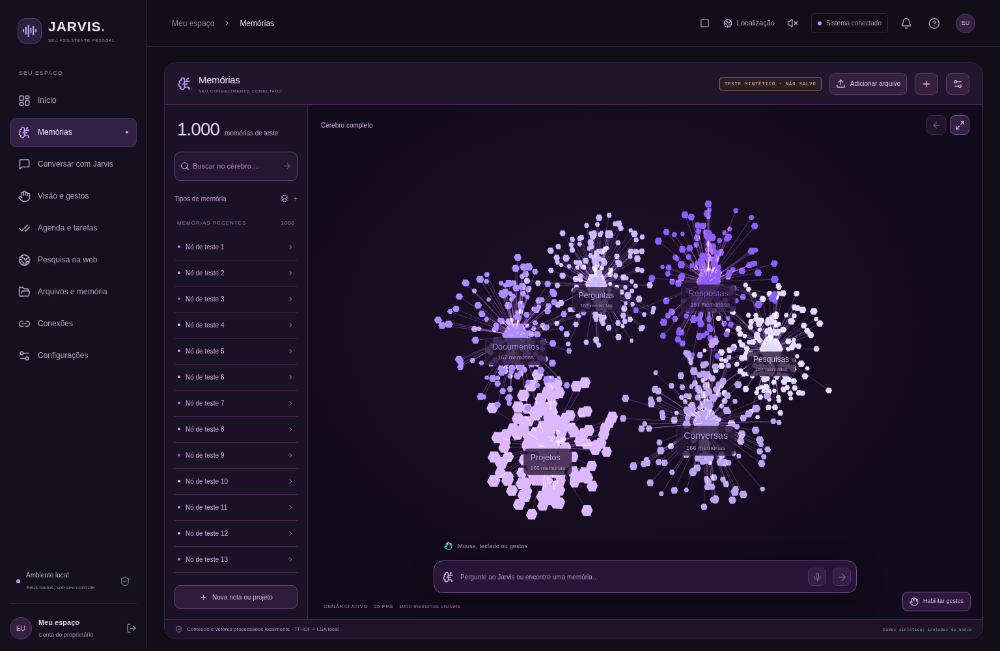

# JARVIS AI — Memória neural 3D

Assistente pessoal em português brasileiro: texto, voz, rastreamento local de mãos e ferramentas com permissões explícitas. A versão 0.3 traz uma interface roxa mais limpa, data/hora ao vivo, localização e clima real, além de respostas faladas acessíveis na tela inicial. O cérebro 3D persistente continua disponível em **Memórias**, com interface React/TypeScript e backend FastAPI/SQLite.

Inspirado na experiência de [holo-gestures](https://github.com/zubair-trabzada/holo-gestures). O código e o design da interface são próprios; veja [recursos e licenças](THIRD_PARTY_NOTICES.md).



A imagem usa o modo de teste isolado. Na utilização normal, os nós representam seus dados persistentes.

## O que está disponível

| Recurso | Estado nesta versão |
| --- | --- |
| Cérebro 3D com memórias persistentes, agrupamentos e relações explicáveis | Implementado; nova tela inicial |
| Pinça simples, dupla e reversa; mouse e teclado | Implementado; calibre e valide os gestos com sua webcam |
| Dashboard responsivo, navegação, estados e preferências | Preservado |
| Chat com histórico persistente e comandos locais | Implementado, funciona sem chave |
| Conversa livre, streaming e ferramentas com SDK OpenAI | Implementado; requer chave e cota; contrato testado com provedor substituto |
| Webcam, até duas mãos, 21 pontos por mão, cursor e pinça | MediaPipe real, pesos e WASM servidos localmente |
| Gestos, suavização, histerese, debounce, cooldown e calibração | Implementado e testado; ajuste com sua webcam física |
| Ditado pt-BR e leitura de respostas | Web Speech API; depende do navegador e suas permissões |
| Tarefas, prioridades, prazos e alertas no painel | Implementado; sem alertas em segundo plano |
| PDF, TXT, MD, DOCX e originais; imagens e vídeos com prévia | Implementado; PDF.js e leitor com pesquisa |
| Busca vetorial local no cérebro, por tipo e data | TF-IDF/LSA local; sem download de modelo |
| Notas, projetos, conversa temporária e controle de salvamento | Implementado |
| Pesquisa na internet com fontes e histórico | Adaptador Brave Search; requer chave |
| Rascunhos e envio de mensagens Telegram | Bot API real; revisão e aprovação de uso único; requer token e chat autorizado |
| Gmail, Calendar, WhatsApp Business, Instagram, Facebook, Discord, Slack, X, YouTube | Planejados, explicitamente identificados; sem conexão simulada |
| Ativação contínua pela palavra “Jarvis”, OAuth, inbox unificada, posts e embeddings pré-treinados | Ainda não implementados |

Não há resultados fictícios, contas conectadas fictícias nem envio automático pelo modelo. A aplicação não oferece shell ou controle irrestrito do computador.

## Instalação no Windows

Pré-requisitos: **Python 3.11+**, **Node.js 24.5+** (recomendado 24 LTS atualizado, inclui npm), Git e Chrome/Edge para o melhor suporte à voz. Abra o PowerShell na pasta em que deseja o projeto:

```powershell
git clone https://github.com/LorddTrolll/Jarvis.git
cd Jarvis
Copy-Item .env.example .env
py -3 scripts/setup.py
py -3 scripts/dev.py
```

Se os arquivos ainda estiverem apenas no ambiente de desenvolvimento, obtenha o código desta pasta antes de executar em outra máquina. O instalador cria `.venv`, instala dependências fixadas e verificadas por hashes, usa `npm ci`, baixa/verifica o modelo MediaPipe e gera o build. Não substitui seu `.env`.

Abra o endereço exibido pelo Vite, na porta **5173** de `localhost`. O backend usa a porta **8000**. O comando de desenvolvimento inicia ambos em loopback; `Ctrl+C` encerra os dois.

## Linux e macOS

```bash
git clone https://github.com/LorddTrolll/Jarvis.git
cd Jarvis
cp .env.example .env
python3 scripts/setup.py
python3 scripts/dev.py
```

Em distribuições que separam `venv` do Python, instale o pacote `python3-venv` pelo gerenciador do sistema. Não desative verificação TLS se houver proxy corporativo: configure a CA fornecida pelo administrador em `SSL_CERT_FILE`/`NODE_EXTRA_CA_CERTS`.

Para iniciar separadamente, **na raiz**:

```bash
# Windows: substitua .venv/bin/python por .venv\Scripts\python.exe
.venv/bin/python -m uvicorn app.server:app --app-dir backend --host 127.0.0.1 --port 8000 --reload
```

Em outro terminal:

```bash
cd frontend
npm run dev
```

O backend também serve `frontend/dist` quando o build existe. Nesse caso, a interface e a API compartilham a porta 8000, sem Vite. As rotas da interface são mantidas no estado da aplicação.

## Configurar IA, busca e Telegram

Edite **`.env` na raiz** e reinicie o backend. Os valores não são disponibilizados ao frontend e não devem entrar no Git. Não use prefixo `VITE_` para chaves.

| Variável | Finalidade |
| --- | --- |
| `JARVIS_OPENAI_KEY` | Chave criada no painel oficial da OpenAI; conversa livre e ferramentas |
| `JARVIS_OPENAI_MODEL` | Modelo com Chat Completions, streaming e function calling; padrão `gpt-4.1-mini` |
| `JARVIS_SEARCH_KEY` | Chave da [Brave Search API](https://api-dashboard.search.brave.com/) |
| `JARVIS_TELEGRAM_TOKEN` | Token de um bot criado pelo [BotFather](https://t.me/BotFather) |
| `JARVIS_PASSWORD` | Senha do proprietário; obrigatória para acesso fora de loopback e para Docker |
| `JARVIS_COOKIE_SECURE` | `true` quando servido por HTTPS; `false` apenas no desenvolvimento local |
| `JARVIS_ALLOWED_ORIGINS` | Origens exatas separadas por vírgulas, com esquema e porta |
| `JARVIS_DATA_DIR` | Diretório dos dados; padrão `data`, relativo ao diretório de execução |
| `JARVIS_HISTORY_DAYS` | Retenção de conversas, pesquisas e auditoria; padrão 30, limpeza na inicialização |
| `JARVIS_API_RATE_PER_MINUTE` | Limite por IP da API; padrão 300. Login tem limite separado de 10/minuto |

Clima e busca de cidades não exigem chave e usam `api.open-meteo.com` e `geocoding-api.open-meteo.com`. A localização aproximada opcional consulta `nominatim.openstreetmap.org`. Se usar uma rede restrita, permita esses hosts. Veja [design, contexto e voz](docs/DESIGN_E_CONTEXTO.md).

Domínios HTTPS dos adaptadores opcionais: `api.openai.com`, `api.search.brave.com` e `api.telegram.org`, conforme os adaptadores que habilitar. A instalação usa npm/PyPI e `raw.githubusercontent.com`. Não é necessário conectar uma conta GitHub pessoal à aplicação.

No Telegram, o destinatário precisa iniciar a conversa com o bot ou autorizar o bot no grupo. Use o `chat_id` numérico obtido pelas APIs oficiais. O conector não lê o histórico da sua conta pessoal. A presença de um token é mostrada como **configurado**, sem alegar que a autenticação foi verificada.

Desconexão: remova a variável do adaptador e reinicie o backend; para revogação efetiva do Telegram, use o BotFather. Não há OAuth nesta versão e nenhum token OAuth é armazenado no banco.

## Usar o Jarvis

1. Entre no seu espaço. Sem senha, o acesso é limitado ao desenvolvimento em loopback.
2. No chat, experimente `abra tarefas`, `crie tarefa Revisar projeto` ou `Jarvis, desligue a câmera`. Com a OpenAI configurada, faça perguntas livres e solicite ferramentas.
3. Em **Início**, clique em **Ativar respostas por voz** para ouvir o assistente; escolha a voz em Configurações. Para ditar, clique no microfone, leia o aviso e conceda a permissão do navegador. O ditado encerra ao terminar a frase. O reconhecimento pode usar servidores do navegador; o Jarvis não grava áudio. Não há escuta contínua ou palavra de ativação.
4. Para mãos, entre em **Visão e gestos** e clique em **Ativar câmera**, abra a mão e aponte. Uma pinça curta seguida de soltura seleciona ações permitidas. Veja [o guia dos gestos](docs/GESTOS.md).
5. Em **Arquivos**, importe documentos. A busca por termos é local e mostra documento, trecho e posição. Em **Memórias**, a busca usa vetores locais e destaca resultados no cenário 3D. O PDF precisa conter texto selecionável; OCR não está incluído. Limites: 10 MB/arquivo, 200 páginas em PDF e 500 mil caracteres extraídos.
6. Para respostas da IA sobre arquivos, ative **Autorizar trechos dos arquivos nesta conversa com IA**, ou **Permitir que a IA consulte minhas memórias** nas configurações do cérebro. Somente então a ferramenta de busca em documentos é exposta ao modelo. Os trechos podem ser enviados à OpenAI; a autorização volta a desligado ao recarregar a página.
7. Clique em **Localização** para buscar uma cidade ou usar a posição aproximada com permissão. O relógio acompanha o fuso selecionado; o clima mostra fonte e horário. `Que horas são?`, `Que dia é hoje?`, `Como está o tempo?` e `Onde estou?` funcionam sem chave de IA; clima requer conexão.
8. Em **Conexões**, prepare um rascunho Telegram, revise destinatário e conteúdo, marque sua autorização e confirme o envio. Uma resposta de sucesso só é exibida após confirmação da API. Se a entrega for incerta, consulte o Telegram antes de tentar novamente.

**Interromper** desliga a câmera, cancela o ditado, a síntese de voz e a resposta em curso. `Esc` interrompe voz/resposta e fecha diálogos. Trocar de aba desliga câmera e voz. Ações de ferramentas já concluídas não são revertidas ao interromper a resposta.

## Cérebro neural e atualização

Leia [MEMORIA_NEURAL.md](docs/MEMORIA_NEURAL.md) para gestos, busca local, privacidade, originais e atualização no Windows preservando `data` e `.env`. A migração mantém os dados anteriores e cria backup local. Documentos antigos continuam com texto extraído; reimporte para recuperar o original.

## Docker

Instale Docker Engine/Desktop com Compose. Copie `.env.example` para `.env`, **defina uma senha forte em `JARVIS_PASSWORD`** e mantenha a origem da porta 8080 na lista permitida:

```bash
docker compose up --build -d
docker compose ps
docker compose logs --tail 50
```

A interface usa a porta **8080**, ligada apenas ao loopback do computador. O backend fica na rede interna do Compose, com healthcheck. Os dados são mantidos no volume `jarvis-data`. `docker compose down` encerra os serviços sem remover o volume. Não use `down -v` se precisar preservar dados.

O build aceita um segredo BuildKit opcional chamado `proxy_ca` para uma CA corporativa; ele não é incorporado à imagem. Veja [detalhes de rede e segurança](docs/ARQUITETURA.md). Antes de disponibilizar fora do seu computador, configure HTTPS, cookie seguro, origem exata e uma senha forte. Esta versão é destinada a um proprietário e um processo de backend; não é uma plataforma multiusuário.

## Testes

Na raiz:

```bash
# Windows: .venv\Scripts\python.exe -m pytest backend/tests -q
.venv/bin/python -m pytest backend/tests -q
cd frontend
npm test
npm run build
npx playwright install chromium
npm run test:e2e
```

Os testes de navegador iniciam servidores nas portas 5173/8000; mantenha-as livres. O runner usa banco temporário separado e câmera sintética do Chromium. Para usar um Chromium existente no Linux, defina `PLAYWRIGHT_CHROMIUM_EXECUTABLE_PATH=/usr/bin/chromium`.

As chaves dos testes são valores de teste e os transportes externos são substituídos. **Esses testes não equivalem a autenticar ou enviar mensagens por uma conta real.** Os resultados da versão neural e as métricas estão em [VALIDACAO_NEURAL.md](docs/VALIDACAO_NEURAL.md). A validação histórica da base está em [VALIDACAO.md](docs/VALIDACAO.md).

Para atualizar as dependências Python intencionalmente, use `uv lock --project backend` e regenere ambos os arquivos `requirements*.lock` com `uv export --frozen --no-emit-project` (sem dev para runtime, `--all-groups` para desenvolvimento). Não edite hashes manualmente.

## Documentação e próximos passos

- [Arquitetura e fronteiras de segurança](docs/ARQUITETURA.md)
- [Gestos e calibração](docs/GESTOS.md)
- [Validação e pendências](docs/VALIDACAO.md)
- [Roteiro das próximas versões](docs/ROADMAP.md)

Próximas evoluções: validar ergonomia com sua câmera/microfone reais, configurar os provedores, adicionar um conector OAuth por vez, evoluir a busca local para embeddings pré-treinados opcionais e implementar agenda conectada. Não exponha esta versão como um serviço público sem revisão de implantação e autenticação.
