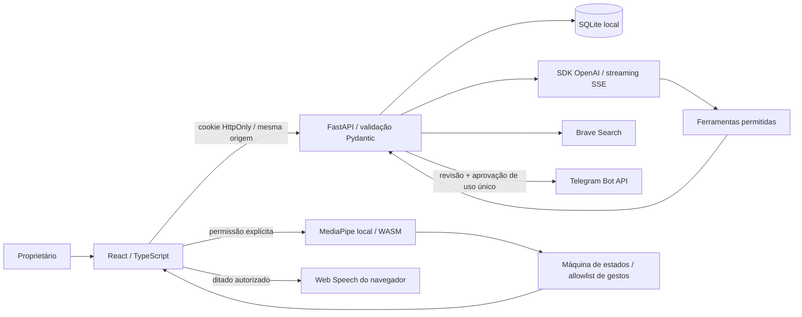

# Arquitetura e segurança



## Módulos

`frontend/src/tracking` administra câmera, carregamento dos pesos, inferência e desenho. `gestures` contém classificação, máquina temporal e o despachante com allowlist. `voice` abstrai o reconhecimento e a síntese do navegador. `api.ts` implementa chamadas e o parser incremental SSE. A interface compartilha estados entre as áreas no `App.tsx`; os componentes comuns estão em `components`.

`backend/app/config.py` concentra configuração; `database.py`, modelos e datas UTC; `schemas.py`, validação; `services.py`, extração/busca de documentos e adaptadores Brave/Telegram; `ai.py`, contexto e ferramentas; `main.py`, sessão, limites e rotas. Os transportes estão separados da orquestração e podem ser substituídos sem alterar o reconhecedor de gestos.

As rotas autenticadas estão sob `/api`. `/api/health` só informa versão/disponibilidade, e `/api/session` permite entrada e consulta de sessão. Swagger em `/docs` expõe o contrato, não dados autenticados. A API usa SSE para a conversa; vídeo e gestos não precisam de WebSocket porque não passam pelo servidor.

## Sessões e implantação

Esta versão é de **um proprietário**. A sessão é aleatória, dura 12 horas e usa cookie `HttpOnly`, `SameSite=Strict`; habilite `Secure` com HTTPS. Sessões e aprovações ficam na memória e são invalidadas ao reiniciar. Use **um worker**, não múltiplos processos. O SQLite persiste dados, não sessões. PostgreSQL/multiusuário e migrações de schema ainda não fazem parte desta versão.

Sem senha, a entrada só é aceita de loopback. Vite também escuta em loopback por padrão. O backend do Docker recebe requisições da rede interna, portanto exige senha. CORS e verificação de `Origin` usam lista exata; requisições com origem externa são recusadas. Clientes locais sem header `Origin` continuam sujeitos à sessão. Login é limitado a 10/minuto por IP; outras rotas têm limite configurável. Esses limites são locais ao processo e não substituem a proteção de um proxy público.

As requisições têm limite de conteúdo declarado, uploads são contados em blocos até 10 MB e textos extraídos têm limites próprios. Arquivos são extraídos para texto e armazenados no SQLite; não são servidos como HTML ou usados como caminhos. DOCX tem limite de tamanho expandido. Documentos cifrados ou inválidos são recusados. O frontend renderiza conteúdo como texto, sem HTML de modelos/provedores.

As URLs de saída são fixas nos adaptadores. O sistema não faz fetch de URLs arbitrárias, nem segue redirecionamentos nas integrações. Links retornados por busca só são apresentados após validação de esquema e hostname; abrir a fonte é uma ação do usuário. Resumo de página arbitrária ainda não é oferecido.

## IA e documentos

O modelo só recebe contexto recente, limitado em quantidade e tamanho. Ferramentas disponíveis usam uma allowlist e esquemas Pydantic; nomes desconhecidos e argumentos inválidos são recusados. Não existem ferramentas de shell, aprovação, envio, exclusão ou publicação. O prompt do sistema separa instruções confiáveis de conteúdo externo; isso reduz ataques de prompt injection, mas não garante a correção do modelo. As fronteiras de permissão independem do prompt.

Documentos nunca são incluídos automaticamente. A ferramenta `search_personal_files` só existe no contexto quando o usuário ativa a autorização da conversa, verificada também no executor. Nesse caso, trechos relevantes retornados pela busca local podem ser enviados ao provedor. A busca inicial é lexical, com normalização de acentos e fragmentação; não usa embeddings nem pretende equivaler a busca semântica.

## Mensagens e confirmação

Criar um rascunho não envia nada. A interface exibe destinatário/conteúdo e exige checkbox de revisão e botão de envio, ambos fora da allowlist de gestos. O servidor gera um token imprevisível com expiração de 120 segundos, ligado à sessão, ao rascunho e a um hash do conteúdo/destinatário. O token não é apresentado ao modelo.

O envio consome a aprovação e faz uma transição atômica de `draft` para `sending`. Aprovações duplicadas não duplicam o envio. Só a confirmação do Telegram muda para `sent` e grava o ID do serviço. Falhas deixam `uncertain`, sem repetição automática; rascunhos interrompidos em `sending` passam a `uncertain` ao reiniciar. Antes de tentar novamente, o usuário precisa consultar o serviço. Não é possível garantir entrega exatamente uma vez se uma conexão cair depois do envio.

## Dados e observabilidade

Conversas, pesquisas e auditoria têm retenção configurável, aplicada na inicialização. Tarefas, documentos e rascunhos permanecem até exclusão. Exclusão em lote é bloqueada durante resposta ou envio. O banco guarda conteúdos em texto no armazenamento local: proteja o disco e seus backups. Exclusão lógica não é garantia de apagamento forense de snapshots/backups.

Logs de ações usam JSON e IDs/nomes de operação; não incluem tokens ou corpo de mensagens. Os loggers HTTPX/HTTPCore não registram URLs em nível informativo, pois a Bot API inclui token no caminho. Não ative depuração HTTP em produção. Chaves são lidas exclusivamente do ambiente do backend, sem endpoint para retornar seus valores.

## Proxy corporativo em builds Docker

O build preserva TLS e hashes. Em redes com proxy, encaminhe os argumentos padrão `HTTP_PROXY`, `HTTPS_PROXY` e `NO_PROXY` ao BuildKit. Se o proxy usa CA privada, o Dockerfile aceita uma CA **fornecida pelo administrador**, montada como segredo `proxy_ca`, usada apenas durante a instalação:

```yaml
# Exemplo de override local; substitua por um caminho real da CA autorizada.
services:
  backend:
    build:
      secrets: [proxy_ca]
  frontend:
    build:
      secrets: [proxy_ca]
secrets:
  proxy_ca:
    file: /caminho/ca-autorizada.pem
```

Use `docker compose -f docker-compose.yml -f seu-override.yml build --build-arg HTTPS_PROXY --build-arg HTTP_PROXY --build-arg NO_PROXY`. Não adicione credenciais de proxy ao Git e não use flags que desativem TLS. Se o Docker não resolver o proxy no ambiente da nuvem, corrija DNS/`extra_hosts` do builder a partir de configuração autorizada. Isso é específico da infraestrutura, não uma mudança de chaves da aplicação.
