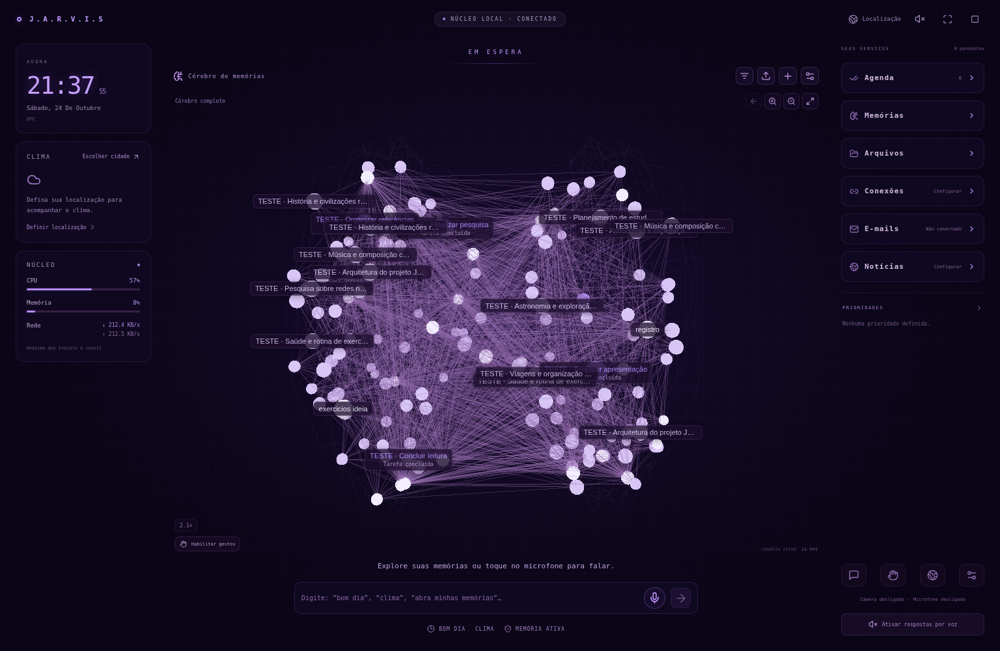

# Cérebro de memórias na tela principal — versão 0.5

O núcleo central agora é o próprio cérebro 3D. O círculo orbital da versão 0.4 foi removido. A rede permanece visível ao abrir o Jarvis e durante a conversa; **Memórias** ou **Explorar memórias** abre a lista de registros ao lado do mesmo cenário, sem criar uma segunda visualização.

[Visualização com o explorador aberto](assets/brain-persisted.png).

A captura usa notas e tarefas marcadas como TESTE, criadas pelas APIs e salvas num banco temporário. Não representa os arquivos do proprietário. Ao usar a aplicação normalmente, os pontos correspondem exclusivamente aos registros existentes no seu banco; a instalação não cria memórias de exemplo.

## O que cada neurônio representa

- Cada esfera tem o mesmo identificador de um registro salvo: documento, imagem, vídeo, nota, projeto, pergunta, resposta, conversa, assunto extraído ou tarefa concluída.
- Não existem esferas extras para categorias, pontos decorativos ou preenchimento artificial. A seleção pode abrir o registro correspondente no leitor.
- A disposição tem dois hemisférios e sulcos corticais. O contorno discreto é apenas uma referência anatômica, desenhada com linhas, sem representar memórias. Um banco vazio mostra esse contorno e o convite para adicionar o primeiro arquivo.
- As conexões visíveis vêm das relações do banco: pergunta/resposta, conversa, fontes, projetos, assuntos e similaridade calculada localmente. O desenho não inventa relações de conteúdo apenas porque dois pontos estão próximos.
- A luminosidade pulsa em fases distintas por neurônio. O efeito não significa que uma ação esteja sendo executada; é a apresentação visual de uma memória já salva. Movimento reduzido desativa a pulsação.

## Aproximar e abrir

Use a roda do mouse ou **Aproximar cérebro** e **Afastar cérebro**. Ao chegar perto, os títulos dos registros aparecem com tamanho legível. Arraste para orbitar e use o botão de enquadramento para voltar ao cérebro completo. A câmera não gira automaticamente.

Um clique ou pinça simples seleciona e aproxima a memória. Clique duplo ou duas pinças abrem seu conteúdo. Pinça reversa volta primeiro ao agrupamento, depois ao cérebro completo. Também é possível selecionar pela lista e apertar `O` para abrir, `Esc`/Backspace para voltar ou `0` para reenquadrar. As ações sensíveis continuam exigindo confirmação direta.

PDF, texto, imagens, vídeos, fontes e registros relacionados continuam usando os leitores existentes. A conversa fica na base da tela, junto aos controles de voz. Data, hora, localização, clima e os demais serviços do painel foram preservados.

## Tarefas concluídas

Concluir uma tarefa na agenda grava automaticamente uma memória com título, prioridade, criação, prazo disponível e horário de conclusão. Não registra uma tarefa pendente como se estivesse feita. Repetir a mesma marcação não duplica o neurônio; reabrir e concluir novamente atualiza o registro da tarefa.

A conclusão anterior permanece como memória enquanto a tarefa é reaberta. Excluir essa memória pelo cérebro preserva a tarefa na agenda e impede que a memória reapareça ao reiniciar. Excluir a tarefa pela agenda remove também sua memória de conclusão. Os demais registros são preservados.

Na primeira inicialização desta versão, tarefas que já estavam concluídas também são importadas, sem duplicação. A versão anterior não registrava o horário da conclusão: nesses casos o leitor informa **Data não registrada na versão anterior**, sem inventar uma data. A captura de tarefas concluídas é independente da preferência de salvar perguntas/respostas, pois a conclusão é uma ação explícita na agenda.

## Atualização e privacidade

Preserve `data` e `.env` e instale a nova versão em outra pasta, conforme [PAINEL_IMERSIVO.md](PAINEL_IMERSIVO.md). Os registros, originais e preferências são mantidos. Posições de câmera do desenho antigo são reenquadradas uma vez para o novo formato; o conteúdo não é recriado nem substituído.

Perguntas/respostas temporárias continuam sem gravação. A autorização para enviar trechos à IA continua desligada por padrão; o desenho e o índice do cérebro funcionam localmente. A retenção de conversas segue a configuração existente, e exclusões continuam refletidas no grafo.

O teste sintético de 1.000 nós permanece somente nas configurações, identificado e separado do banco. Ele não fornece arquivos fictícios ao leitor e bloqueia o envio de perguntas enquanto estiver ativo. Não confunda esse benchmark com o cenário normal de dados persistidos.

Os resultados e limites da verificação estão em [VALIDACAO_CEREBRO_PRINCIPAL.md](VALIDACAO_CEREBRO_PRINCIPAL.md).
