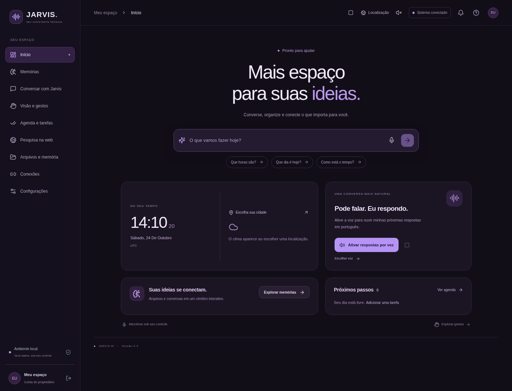

# Interface, contexto e voz — versão 0.3

O **Início** reúne conversa, relógio, clima, respostas por voz, memórias e próximos passos. A paleta usa ameixa, violeta e lavanda; os indicadores decorativos e a coluna permanente de status foram removidos. A prévia da câmera só aparece quando ativada, em uma área própria. O cérebro continua em **Memórias**, com filtros recolhidos e controles de mouse, teclado e gestos preservados.



## Data, hora, local e clima

- O relógio atualiza a cada segundo. Sem cidade, usa o fuso IANA do navegador; com cidade, usa o fuso informado pelo serviço. O fuso aparece ao lado da data para distinguir o horário escolhido do horário do computador. `tzdata` está incluído para Windows.
- Clique em **Localização** no topo ou no nome da cidade no cartão. Digite a cidade e escolha um dos resultados. Essa preferência fica no armazenamento local deste navegador e pode ser removida no mesmo diálogo.
- **Usar minha localização** só solicita a posição após um clique e a permissão do navegador. As coordenadas são arredondadas para duas casas decimais antes de sair do navegador, uma aproximação da ordem de 1 km. Precisão e disponibilidade variam conforme o dispositivo. GPS não é necessário para escolher uma cidade.
- A posição aproximada é consultada no OpenStreetMap/Nominatim para identificar a cidade e no Open-Meteo para consultar o clima. Ela fica em memória durante a sessão e é descartada ao sair ou recarregar; não vai para o banco de memórias nem para o armazenamento local. A cidade escolhida manualmente pode permanecer entre sessões.
- O clima mostra temperatura, sensação térmica, umidade, mínima/máxima do dia, fonte e horário dos dados. São condições atuais fornecidas pelo Open-Meteo, não uma estação física do Jarvis. Consultas meteorológicas têm cache de dez minutos e atualização periódica enquanto a página está visível. O botão de atualizar respeita esse cache.
- Sem conexão ou resposta válida, a interface explica a indisponibilidade. Não há cidade, temperatura ou previsão fictícias. A aplicação não deduz sua localização por IP nem pelo fuso do computador.

Provedores sem chave: [Open-Meteo](https://open-meteo.com/) para cidades/clima e [OpenStreetMap](https://www.openstreetmap.org/copyright) para identificação da cidade a partir da posição aproximada. Esses serviços recebem a consulta solicitada. As chamadas usam endpoints HTTPS fixos pelo backend autenticado, sem redirecionamentos. Coordenadas viajam em corpos POST, para não aparecerem nas URLs do log de acesso do Jarvis; o servidor mantém apenas um cache limitado e temporário. O Nominatim tem limite de uma consulta por segundo por instância e cache de um dia.

Domínios necessários em redes restritas: `geocoding-api.open-meteo.com`, `api.open-meteo.com`, `nominatim.openstreetmap.org`. Câmera, microfone e geolocalização requerem contexto seguro: loopback local ou HTTPS em um servidor remoto.

## Respostas por voz

1. Clique em **Ativar respostas por voz** no Início. O Jarvis lê uma apresentação e passa a ler as próximas respostas. O botão de alto-falante no topo também controla essa preferência.
2. Para falar sua pergunta, clique no microfone e autorize o reconhecimento de voz. Ele encerra ao terminar a frase. A transcrição é enviada ao mesmo fluxo da conversa digitada.
3. Use **Interromper fala**, o botão global de interrupção ou `Esc` para cancelar a leitura. Trocar de aba também a interrompe. Desativar respostas por voz cancela a fala atual e impede a leitura de respostas ainda em andamento.
4. Em **Configurações**, escolha uma voz em português e clique em **Testar voz**. As opções dependem das vozes instaladas/disponibilizadas pelo navegador e pelo Windows.

A síntese usa a Web Speech API, divide respostas longas em frases curtas e ignora callbacks de falas canceladas. Remove marcação Markdown, não lê blocos de código e indica que links estão na tela. O botão **Ouvir** permite ler uma resposta específica mesmo com leitura automática desligada. Nenhuma fala começa automaticamente ao abrir a aplicação.

O reconhecimento pode enviar áudio ao serviço do navegador. Algumas vozes de síntese também dependem de serviços do sistema/navegador e conexão; o Jarvis não oferece uma garantia de voz offline. Ele não grava áudio e não implementa escuta contínua nem palavra de ativação.

Comandos locais sem chave de IA: `Olá`, `Que horas são?`, `Que dia é hoje?`, `Como está o tempo?`, `Onde estou?`, além dos comandos anteriores de tarefas, navegação e câmera. Clima exige uma localização selecionada e conexão. **Onde estou?** informa a localização selecionada, sem alegar que uma cidade escolhida manualmente é a posição física do dispositivo. Conversa livre continua dependendo do provedor de IA configurado.

As coordenadas não são anexadas ao contexto do modelo de IA. Um pedido local de clima, quando a gravação da conversa estiver ativada, pode salvar a resposta com o nome da cidade no histórico, como qualquer resposta. Use conversa temporária para evitar salvar perguntas/respostas. Remover a localização não apaga conversas antigas.

## Atualizar no Windows preservando os dados

Encerre o Jarvis com `Ctrl+C`. Faça uma cópia de segurança da pasta `data` e do arquivo `.env`. Baixe a versão nova em outra pasta, extraia e copie o backup de `data` e `.env` para a raiz dessa versão. No terminal da pasta nova:

```bat
py -3 scripts/setup.py
py -3 scripts/dev.py
```

Aguarde a inicialização completa e abra o endereço exibido pelo Vite. Se já estiver aberto, atualize a página com `Ctrl+F5`. Não execute as duas versões simultaneamente. O instalador inclui a dependência de fusos horários para Windows e preserva os dados copiados.

## Validação desta entrega

Os resultados específicos estão em [VALIDACAO_DESIGN.md](VALIDACAO_DESIGN.md). Câmera, microfone e reprodução física de som precisam ser conferidos no computador do proprietário; testes com dispositivos/serviços simulados não equivalem a essa conferência.
