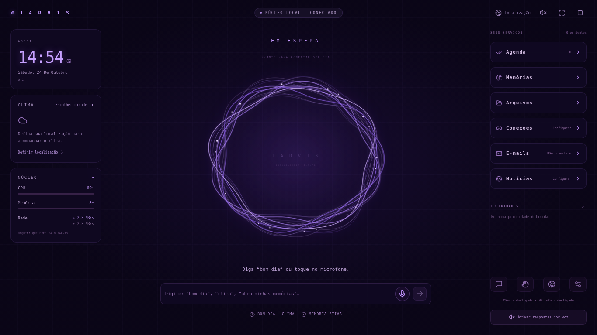

# Jarvis — painel imersivo e janela local, versão 0.4

> Desde a versão 0.5, o círculo central descrito neste documento foi substituído pelo cérebro de memórias. Veja [CEREBRO_PRINCIPAL.md](CEREBRO_PRINCIPAL.md). O iniciador e os demais serviços continuam disponíveis.

A interface foi refeita a partir da referência do proprietário: núcleo luminoso ao centro, contexto à esquerda, serviços à direita e entrada de voz/texto na base. A paleta permanece violeta. Foram removidos o menu lateral de páginas, avatar, perfil, nome de conta, saudação de site e tela de entrada do uso local normal.

## Abrir no Windows

Com Python 3.11+ e Node.js 24.5+ instalados, dê dois cliques em **Iniciar Jarvis.bat**, na raiz do projeto. Na primeira execução, se faltarem o ambiente Python ou o frontend compilado, o iniciador executa a instalação existente. Ela continua usando dependências fixadas, verificação de hashes e arquivos MediaPipe locais.

O iniciador prepara o backend e abre uma **janela de aplicativo do Edge ou Chrome**, sem abas e sem barra de endereço. É uma aplicação local que usa o motor do navegador; não é um instalador `.exe` nem um serviço instalado no Windows. Se Edge/Chrome não forem encontrados, o navegador padrão é usado como alternativa. O botão de tela cheia e `F11` estão disponíveis.

Mantenha o console do iniciador aberto enquanto usa o Jarvis. `Ctrl+C` nele encerra o backend iniciado por esse processo. Fechar somente a janela da interface não encerra o núcleo. O iniciador não instala serviço de inicialização automática nem altera configurações do Windows.

Para atualizar, encerre a versão antiga e preserve `data` e `.env`. Extraia a nova versão em outra pasta, copie esses dois itens e use o novo iniciador. O build `frontend/dist` não faz parte do ZIP do Git: ele será produzido pela instalação da versão nova. Não copie `dist`, `.venv` ou `node_modules` de versões anteriores.

## Como o painel funciona

- **Núcleo:** muda entre espera, escuta, processamento e resposta. As linhas orbitais reagem ao estado de voz; animações respeitam a preferência de movimento reduzido e param quando a interface fica oculta ou um módulo é aberto.
- **Hora e data:** atualizadas ao vivo, no fuso do navegador ou da cidade escolhida. Localização e clima mantêm os controles e a privacidade da versão 0.3, descritos em [DESIGN_E_CONTEXTO.md](DESIGN_E_CONTEXTO.md).
- **Clima:** consulta real ao Open-Meteo, com temperatura, condição, mínima/máxima, sensação, umidade, fonte e horário. Não exibe uma previsão fictícia quando o serviço está indisponível.
- **Núcleo da máquina:** CPU e memória são medidas pelo backend com psutil. Rede mostra bytes por segundo recebidos/enviados, sem inventar uma porcentagem de capacidade. São dados da máquina que executa o Jarvis, não necessariamente do dispositivo que abriu a interface. A primeira amostra de CPU/rede pode aparecer como `—` até existir um intervalo mensurável; a coleta pausa na interface oculta.
- **Serviços:** agenda, memórias, arquivos, pesquisa, conexões e ajustes abrem módulos sobre o painel. `Esc` fecha o módulo e interrompe voz/resposta; fechar um módulo preserva os dados. A câmera ocupa uma área própria e não intercepta controles do cérebro.
- **Voz:** clique no microfone para ditar, após o aviso e a permissão. Esse modo ativa também a leitura das respostas. O botão de alto-falante permite alternar a leitura, e os controles de interrupção cancelam a fala. Não há escuta contínua por palavra de ativação.
- **Bom dia:** consulta o relógio, tarefas pendentes e prioridades do banco local e acrescenta o clima quando há localização selecionada e consulta disponível. A resposta fica no centro e pode ser falada. Não requer chave de IA. A agenda citada é a agenda local do Jarvis, não um calendário externo.
- **Notícias:** abre uma consulta de notícias atuais pela integração Brave Search já existente. Só consulta automaticamente após o clique quando a chave está configurada. Sem chave, mostra o estado de configuração e não inventa manchetes.

Memórias 3D, arquivos originais, pinça simples/dupla/reversa, controles de mouse/teclado, conversa temporária, autorização de documentos e confirmação de envios continuam disponíveis. **Conversa** abre o histórico completo; a tela principal mostra a última resposta.

## Integrações disponíveis

O painel unifica os serviços implementados. Telegram continua como adaptador real com revisão de destinatário/conteúdo e aprovação de uso único. OpenAI e Brave dependem das respectivas chaves; clima e localização não exigem chave.

**E-mail, calendário externo e os demais conectores de contas ainda não estão implementados.** O botão E-mails informa isso e permite ver as conexões disponíveis. Ele não acessa caixa de entrada nem envia mensagens. Nenhuma conta é mostrada como sincronizada sem conexão real. A interface não concede execução arbitrária de shell ou acesso irrestrito ao sistema operacional.

## Sessão local e proteção

Sem senha configurada, o frontend inicia a sessão automaticamente; o backend continua limitando esse modo a loopback. A aplicação não tem cadastro nem perfis de usuários.

O iniciador cria uma capacidade aleatória efêmera e a entrega à janela local pelo fragmento da URL. O frontend a remove imediatamente da barra/histórico e troca essa capacidade por um cookie de sessão HttpOnly. Ela não é gravada em `data`, `.env`, respostas de status ou logs. O backend só aceita essa forma de entrada em conexão de loopback e com a capacidade correta. A senha configurada continua exigida fora desse fluxo. Ao iniciar, o processo verifica a identidade da própria instância, além da versão, antes de abrir a janela.

A porta preferida do aplicativo é 8765; se estiver ocupada, uma porta livre é escolhida. O servidor escuta somente `127.0.0.1`. Os fluxos de desenvolvimento Vite/FastAPI e Docker continuam existindo separadamente; a sessão de aplicativo não remove as proteções de acesso remoto.

## Validação

Os testes automatizados incluem autenticação da janela local, recusa de capacidade inválida/remota, telemetria real e cálculo por deltas, resumo diário com tarefas reais, entrada direta, abertura/fechamento de módulos, voz, clima, gestos e leitores de arquivos. A verificação do iniciador em Linux exercita um backend real, arquivos compilados, sessão protegida e encerramento, com a abertura da janela substituída por um cliente de teste. Não comprova a abertura física do Edge no Windows.

Webcam, mãos, microfone, alto-falantes e janela física no Windows ainda devem ser conferidos no computador do proprietário. Consultas reais aos provedores meteorológicos continuam dependentes de uma rede que permita os três domínios documentados. Veja os resultados em [VALIDACAO_HUD.md](VALIDACAO_HUD.md).
