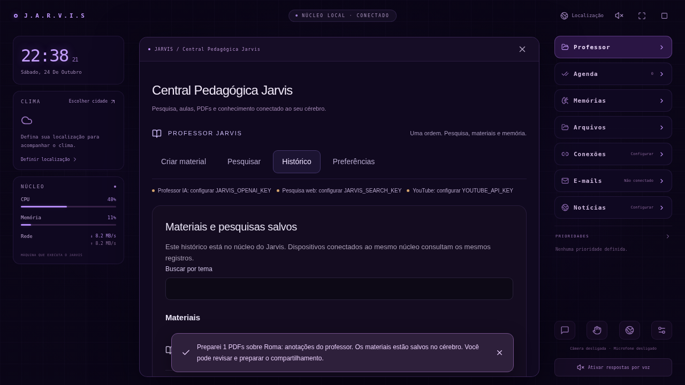

# Validação da Central Pedagógica · 0.6

Verificado em 24/10/2026, Linux, Python 3.12 e Chromium do ambiente. O código inclui o instalador Windows; a abertura física no computador do proprietário permanece a validar.

| Verificação | Resultado |
| --- | --- |
| `python3 scripts/setup.py` com caches em `/workspace/.cache` | Instalação por lockfiles com hashes, modelo MediaPipe conferido e build de produção concluídos |
| `.venv/bin/python -m pytest backend/tests -q` | 54 testes passaram |
| `npm test` em `frontend` | 31 testes passaram |
| `PLAYWRIGHT_CHROMIUM_EXECUTABLE_PATH=/usr/bin/chromium npm run test:e2e` | 23 testes passaram |
| `git diff --check` | Sem erros de espaços |

As quatro fases foram verificadas em sequência: pesquisa e metadados; geração real dos materiais; persistência/revisões no cérebro; revisão e compartilhamento assistido. A suíte completa foi executada após a integração. Total: **108 testes**, sem testes ignorados. O build mantém o aviso já conhecido sobre o tamanho do módulo 3D carregado sob demanda; a geração dos arquivos foi concluída.

O cenário completo do Império Romano passa pelo comando no chat (mesma entrada usada pelo ditado), interpretador de quantidades, pesquisa, contratos YouTube/OpenAI, revisão por IA substituída no teste, geração de seis PDFs, separação do gabarito, arquivos do cérebro, ZIP e recuperação por voz/texto. Somente respostas externas são fixtures de teste; os PDFs, banco, arquivos, leitores e relações são reais. A quantidade solicitada, URLs de vídeos, presença dos originais, relação 16:9 e ausência do gabarito no arquivo de atividades são conferidas.

Também foram testados: ausência de credenciais, falha de provedor sem exposição da chave, remoção de URLs/códigos sem evidência, todos os onze tipos de material, numeração/quantidades inválidas, cancelamento, recuperação de execução interrompida, preferência geral de não salvar, retenção de material sem vínculo, nova revisão preservando a anterior, acesso por segunda sessão ao mesmo banco, exclusão e bloqueio de falso estado “enviado”.

No navegador, um PDF de texto próprio é gerado pelo backend e efetivamente desenhado em canvas, com verificação de pixels. O fluxo de download é executado. A simulação controlada de `navigator.share` recebe um `File` cujo conteúdo começa com `%PDF`, após revisão e clique; o estado final é “sistema retornou; entrega não verificada”. Isso não equivale a abrir o aplicativo WhatsApp ou entregar um documento a um grupo real.

Captura de um banco temporário de teste. O texto “Roma: anotações do professor” foi criado pelo teste do PDF próprio; não é preenchimento demonstrativo da instalação. As três APIs aparecem sem credenciais, correspondendo ao estado real do ambiente.

Não havia chaves OpenAI, Brave ou YouTube utilizáveis no ambiente, nem bindings salvos para os provedores existentes. As consultas de documentação externa também foram bloqueadas pelo proxy. Portanto, autenticação/cota real, qualidade de uma aula produzida pelo modelo real e busca real no YouTube permanecem sem validação neste ambiente. O adaptador usa os endpoints e parâmetros oficiais indicados no [guia](CENTRAL_PEDAGOGICA.md), sem inventar resultados para substituir essas verificações. Microfone/webcam físicos, compartilhamento nativo do dispositivo do proprietário e entrega WhatsApp também não foram validados.
